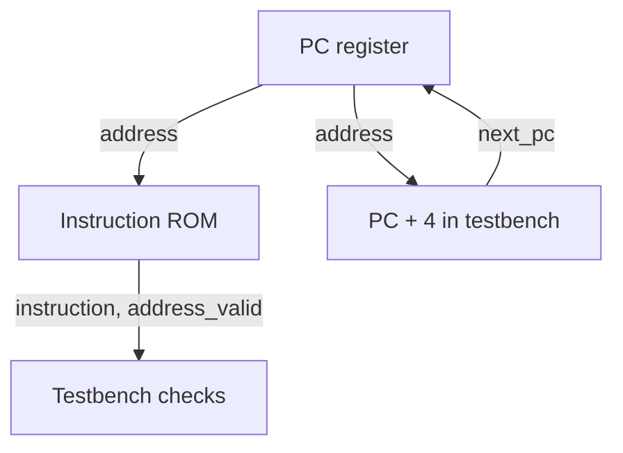

# Phase-1 block diagram

Assigned owner: Viraj. Prepared with assistant support from the real module
connections in `tb/tb_fetch.sv`. The observer and PC+4 expression are testbench
logic; this is not a complete synthesizable CPU top.

The PC receives `clk`, `reset` and `enable` from the testbench. Clock/reset are
not inputs to the ROM. The diagram's feedback path updates the PC only on a
rising edge when enable is high and reset is low.

## Signal-to-source mapping

| Signal | Width | Direction and actual connection |
|---|---:|---|
| `clk` | 1 | Testbench drives `pc_state.clk`; toggles every 5 ns |
| `reset` | 1 | Testbench drives `pc_state.reset`; synchronous, active high |
| `enable` | 1 | Testbench drives `pc_state.enable`; low holds current_pc |
| `next_pc` | 32 | PC input connected to testbench expression `address + 32'd4` |
| `current_pc` / `address` | 32 | PC output connected directly to `rom.address` |
| `instruction` | 32 | ROM output observed by testbench checks |
| `address_valid` | 1 | ROM output observed by testbench checks |

The ROM maps the byte address to a word only after verifying upper address bits
and low alignment bits. On an invalid address the output word is zero and the
valid flag is low. There is currently no feedback from that flag to PC enable;
the future CPU must add fault gating. The present bench deliberately fetches
0x400 to test the indication.

## Walk through the connections

1. A rising edge with reset asserted sets current_pc to zero.
2. The address wire immediately selects the first ROM word, `00500093`.
3. Testbench combinational arithmetic supplies 4 as the next PC.
4. The next enabled rising edge changes the address to 4 and selects `00a00113`.
5. With enable low, PC and the selected instruction remain unchanged.

This same path fetches the BEQ word at address 0x14 and then advances to 0x18.
There is no instruction decoder, comparison or branch-target selector yet.

## Future connections, not present in this diagram

| Planned addition | Role in the final processor |
|---|---|
| Decoder and immediate generator | Interpret instruction fields and I/S/B immediates |
| Register file and ALU | Read operands and compute arithmetic or data addresses |
| Data RAM and writeback mux | Store words and select load versus ALU results |
| Branch unit and PC selection | Choose current PC+B-immediate for taken BEQ/BNE |
| Fault/reset gating and CPU top | Prevent state writes on invalid instructions or accesses |

See the [overview](processor-overview.md) for the full scope and the
[design decisions](design-decisions.md) for the reasons behind these interfaces.
