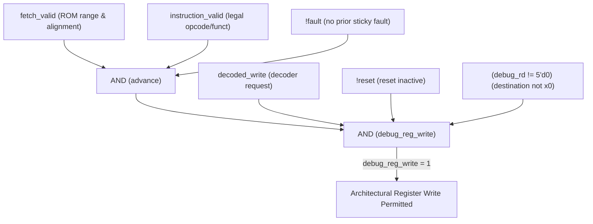

# Control Signals, Reset Gating, and Diagnostic Fault Handling

This document provides a comprehensive technical analysis of the control signals, writeback qualification, synchronous reset behavior, and diagnostic fault classification in the Phase-3 single-cycle RV32I processor (`rtl/rv32i_cpu.v`).

---

## 1. Master Control Signal Truth Table

The combinational control unit (`rtl/control_unit.v`) and datapath evaluate each 32-bit instruction to produce four primary control signals, accompanied by the ALU multiplexer output and writeback configuration:

| Instruction | Opcode `[6:0]` | Funct3 `[14:12]` | Funct7 `[31:25]` | `instruction_valid` | `decoded_write` (`reg_write`) | `alu_src_immediate` | `alu_operation [2:0]` | Selected ALU Operation |
|---|---|---|---|---|---|---|---|---|
| `ADD` | `7'h33` | `3'b000` | `7'b0000000` | `1'b1` | `1'b1` | `1'b0` (operand2) | `3'd0` | Modulo-32 Addition |
| `SUB` | `7'h33` | `3'b000` | `7'b0100000` | `1'b1` | `1'b1` | `1'b0` (operand2) | `3'd1` | Modulo-32 Subtraction |
| `AND` | `7'h33` | `3'b111` | `7'b0000000` | `1'b1` | `1'b1` | `1'b0` (operand2) | `3'd2` | Bitwise AND |
| `OR` | `7'h33` | `3'b110` | `7'b0000000` | `1'b1` | `1'b1` | `1'b0` (operand2) | `3'd3` | Bitwise OR |
| `XOR` | `7'h33` | `3'b100` | `7'b0000000` | `1'b1` | `1'b1` | `1'b0` (operand2) | `3'd4` | Bitwise XOR |
| `ADDI` | `7'h13` | `3'b000` | *Immediate bits* | `1'b1` | `1'b1` | `1'b1` (immediate) | `3'd0` | Modulo-32 Addition |
| *Unsupported / Invalid* | *Other* | *Other* | *Other* | `1'b0` | `1'b0` | `1'b0` | `3'd0` | Suppressed (Default) |

### Verified ALU Operation Encodings (`rtl/alu.v`)
```verilog
case (operation)
    3'd0: result = a + b;
    3'd1: result = a - b;
    3'd2: result = a & b;
    3'd3: result = a | b;
    3'd4: result = a ^ b;
    default: result = 32'd0;
endcase
```
The five arithmetic/logical operations use codes `0` through `4`. Operation codes `5`, `6`, and `7` are unmapped and return `32'd0`.

---

## 2. Decoded Write Request vs. Final Qualified `debug_reg_write`

A central design principle in `rtl/rv32i_cpu.v` is the distinction between a **decoder write request** (`decoded_write`) and the **actual architectural write permit** (`debug_reg_write`).

### Gating Logic Equations
```verilog
assign advance = !fault && fetch_valid && instruction_valid;
assign debug_rd = debug_instruction[11:7];
assign debug_reg_write = advance && decoded_write && !reset && (debug_rd != 5'd0);
```

While `decoded_write` simply asserts that the instruction format dictates a destination write (true for all 6 supported instructions), `debug_reg_write` validates five independent architectural preconditions:



### Truth Table for Write Qualification

| `reset` | `fault` (prior) | `fetch_valid` | `instruction_valid` | `decoded_write` | `debug_rd` | `advance` | `debug_reg_write` | Effect on Register File |
|:---:|:---:|:---:|:---:|:---:|:---:|:---:|:---:|---|
| **1** | X | X | X | X | X | 0 (if fault/inv) / 1 | **0** | No write; synchronous clear active |
| 0 | **1** | X | X | X | X | **0** | **0** | No write; CPU halted on prior fault |
| 0 | 0 | **0** | X | X | X | **0** | **0** | No write; invalid ROM address/alignment |
| 0 | 0 | 1 | **0** | X | X | **0** | **0** | No write; unsupported instruction word |
| 0 | 0 | 1 | 1 | **0** | X | 1 | **0** | No write; non-writing instruction |
| 0 | 0 | 1 | 1 | 1 | **5'd0** | 1 | **0** | No write; `x0` write suppressed |
| 0 | 0 | 1 | 1 | 1 | **Non-zero** | **1** | **1** | **Legal Write**: `registers[rd] <= debug_write_data` |

---

## 3. Program Counter Progression and Hold Conditions

The program counter instance `u_pc` (`rtl/pc.v`) updates synchronously on the rising clock edge:
```verilog
always @(posedge clk) begin
    if (reset)
        current_pc <= RESET_PC;
    else if (enable)
        current_pc <= next_pc;
end
```
In `rv32i_cpu.v`, port `.enable` is bound to the `advance` wire:
$$\text{advance} = (\neg \text{fault}) \land \text{fetch\_valid} \land \text{instruction\_valid}$$

### Conditions for PC Advance vs. PC Hold
1. **Normal Advancement**:
   When the processor is not in a fault condition (`fault == 0`), the fetch address is within range and aligned (`fetch_valid == 1`), and the instruction is one of the six supported operations (`instruction_valid == 1`), `advance = 1'b1`. At `posedge clk`, `current_pc` captures `next_pc` (`debug_pc + 32'd4`).
2. **PC Hold on Diagnostic Fault**:
   If an out-of-range/unaligned address is encountered (`fetch_valid == 0`) or an illegal/unsupported instruction is decoded (`instruction_valid == 0`), `advance` drops to `1'b0` **within the current cycle**.
   Because `enable = 0`, the PC register holds its value across the clock edge, preserving the exact address of the faulting instruction for post-mortem inspection.
3. **PC Hold on Sticky State**:
   Once `fault` is latched high, `!fault` evaluates to `0`, permanently holding `advance = 0`. The processor freezes execution and makes no further progress until a hardware reset occurs.

---

## 4. Sticky Fault Diagnostic Mechanism

The CPU diagnostic unit classifies abnormal execution events into a 2-bit code:

```verilog
always @(posedge clk) begin
    if (reset) begin
        fault <= 1'b0;
        fault_cause <= 2'b00;
    end else if (!fault) begin
        if (!fetch_valid) begin
            fault <= 1'b1;
            fault_cause <= 2'b01;
        end else if (!instruction_valid) begin
            fault <= 1'b1;
            fault_cause <= 2'b10;
        end
    end
end
```

### Diagnostic Fault Encodings

| `fault` | `fault_cause` | Condition | Description | Architectural Outcome |
|:---:|:---:|---|---|---|
| `0` | `2'b00` | Normal Operation | Normal execution or active hardware reset | PC advances by 4; valid register writes commit. |
| `1` | `2'b01` | **Invalid Fetch** | `!fetch_valid`: Address $\ge 1024$ bytes or misaligned (`address[1:0] != 2'b00`). | PC holds at invalid address; writes suppressed. |
| `1` | `2'b10` | **Unsupported Instruction** | `!instruction_valid`: Opcode/funct3/funct7 outside 6 supported operations. | PC holds at faulting address; writes suppressed. |

### Pre-Edge Suppression Property
Crucially, when a faulting condition occurs during cycle $N$:
1. `fetch_valid` or `instruction_valid` combinationally goes low.
2. `advance` immediately drops to `1'b0` within cycle $N$.
3. `debug_reg_write` immediately drops to `1'b0` within cycle $N$.
4. Therefore, **prior to the rising clock edge**, no write enable is asserted to the register file.
5. At the rising clock edge, `fault` transitions from `0` to `1` and `fault_cause` latches `01` or `10`. The register file captures nothing.
6. The faulting instruction cannot mutate architectural registers before or during the edge that records the fault.

### Synchronous Reset Priority and Recovery
The synchronous reset signal has highest priority in `rv32i_cpu.v`:
- When `reset = 1'b1`, `debug_reg_write` is forced to `0` combinationally (`!reset` term).
- At the next `posedge clk`:
  - `fault <= 1'b0`
  - `fault_cause <= 2'b00`
  - `u_pc.current_pc <= RESET_PC`
  - All 32 general-purpose registers in `u_register_file` are cleared to `32'd0`.
- This cleanly recovers the processor from any sticky fault condition, returning all internal state to the initial reset configuration.

---

## 5. Combinational Write Trace vs. Registered Retirement Record

The processor outputs five top-level debug signals:
- `debug_pc [31:0]`
- `debug_instruction [31:0]`
- `debug_reg_write`
- `debug_rd [4:0]`
- `debug_write_data [31:0]`

### Nature of the Debug Interface
It is vital to distinguish these signals from a retired instruction fifo or delayed commit log:
1. **Purely Combinational**:
   `debug_pc` is the current registered PC output. `debug_instruction` is the asynchronous ROM output for that PC. `debug_rd`, `debug_write_data`, and `debug_reg_write` are combinational functions of the current instruction and ALU evaluation.
2. **Pre-Commit Observation Window**:
   These signals describe the operation that **will be committed** at the upcoming rising clock edge. In testbenches (such as `tb/tb_rv32i_cpu.sv`), the verification environment checks `debug_reg_write` and `debug_write_data` immediately before driving the rising clock edge (`#4; clk=1;`).
3. **Not a Delayed Retirement Record**:
   In pipelined or superscalar architectures, a retirement record reflects an instruction that completed and committed several cycles after fetch. Here, in a single-cycle core, the debug trace exposes the live, uncommitted combinational datapath outputs for the current cycle.

---

## 6. Pedagogical Diagnostics vs. Privileged Trap Architecture

The diagnostic fault hold implemented in Phase 3 is a **teaching diagnostic aid**, deliberately distinct from the formal RISC-V Privileged Architecture:
- In the full RISC-V privileged specification (Volume II), an illegal instruction or instruction address misaligned exception triggers a trap:
  - The core switches privilege mode (e.g., to Machine mode).
  - The faulting instruction address is written to `mepc`.
  - The trap cause is encoded into `mcause`.
  - The faulting instruction or bad address is saved in `mtval`.
  - Control vectors to the address stored in `mtvec`.
  - State execution continues under a software trap handler.
- In this Phase-3 undergraduate implementation:
  - There are no CSRs (`mepc`, `mcause`, `mtstatus`, `mtvec`).
  - There is no privileged mode or software trap handler.
  - The processor simply halts (`advance = 0`) and asserts a sticky diagnostic flag (`fault = 1`, `fault_cause = 01/10`) to allow straightforward testbench assertion checking and waveform inspection.
