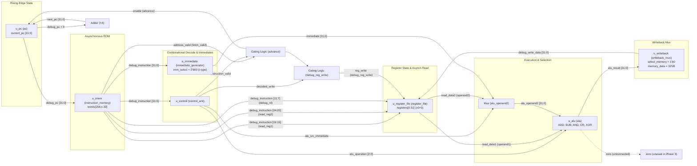

# Implemented Single-Cycle Arithmetic Datapath

This document details the architectural datapath implemented in Phase 3 of the single-cycle RV32I processor (`rtl/rv32i_cpu.v`). It documents the exact module instances, port mappings, combinational data flows, rising-edge state updates, operand multiplexing, writeback qualification, and execution traces for the implemented arithmetic instruction subset (`ADD`, `SUB`, `AND`, `OR`, `XOR`, and `ADDI`).

---

## 1. Top-Level Core Datapath Architecture

The Phase-3 processor core executes arithmetic instructions in a single clock cycle. All state transitions occur synchronously on the rising clock edge (`posedge clk`). Between clock edges, instruction fetch, instruction decode, register access, immediate generation, operand selection, ALU calculation, and writeback multiplexing proceed combinationally.

### Connected Modules and Signal Interconnect



---

## 2. Implemented Module Instances and Port Mappings

The table below maps the structural Verilog instantiation in `rtl/rv32i_cpu.v` to the underlying RTL modules:

| Instance Name | Module Name | Connected Ports | Combinational vs. Clocked |
|---|---|---|---|
| `u_pc` | `pc` (`rtl/pc.v`) | `.clk(clk)`<br>`.reset(reset)`<br>`.enable(advance)`<br>`.next_pc(debug_pc + 32'd4)`<br>`.current_pc(debug_pc)` | **Rising-edge state** (`current_pc <= next_pc` on `posedge clk` when enabled; synchronously resets to `RESET_PC`). |
| `u_imem` | `instruction_memory` (`rtl/instruction_memory.v`) | `.address(debug_pc)`<br>`.instruction(debug_instruction)`<br>`.address_valid(fetch_valid)` | **Combinational**: Asynchronous ROM indexed by `debug_pc[9:2]`. Validates alignment (`address[1:0] == 2'b00`) and 1 KiB range (`address[31:10] == 22'd0`). |
| `u_control` | `control_unit` (`rtl/control_unit.v`) | `.instruction(debug_instruction)`<br>`.instruction_valid(instruction_valid)`<br>`.reg_write(decoded_write)`<br>`.alu_src_immediate(alu_src_immediate)`<br>`.alu_operation(alu_operation)` | **Combinational**: Pure combinational decoder evaluating opcode `instruction[6:0]`, `funct3`, and `funct7`. |
| `u_register_file` | `register_file` (`rtl/register_file.v`) | `.clk(clk)`<br>`.reset(reset)`<br>`.reg_write(debug_reg_write)`<br>`.read_reg1(debug_instruction[19:15])`<br>`.read_reg2(debug_instruction[24:20])`<br>`.write_reg(debug_rd)`<br>`.write_data(debug_write_data)`<br>`.read_data1(operand1)`<br>`.read_data2(operand2)` | **Mixed**: Reads are purely combinational (`read_data1`, `read_data2`). Writes are **rising-edge state** (`registers[write_reg] <= write_data` on `posedge clk` when `reg_write && write_reg != 0`). Synchronous reset clears registers. |
| `u_immediate` | `immediate_generator` (`rtl/immediate_generator.v`) | `.instruction(debug_instruction)`<br>`.imm_select(2'b00)`<br>`.immediate(immediate)`<br>`.format_valid()` | **Combinational**: Wired to selector `2'b00` (I-type). Sign-extends `instruction[31:20]` across the upper 20 bits. Output `.format_valid()` is left open. |
| `u_alu` | `alu` (`rtl/alu.v`) | `.a(operand1)`<br>`.b(alu_operand2)`<br>`.operation(alu_operation)`<br>`.result(alu_result)`<br>`.zero()` | **Combinational**: Evaluates 32-bit arithmetic and bitwise logic. Port `.zero()` is left open. |
| `u_writeback` | `writeback_mux` (`rtl/writeback_mux.v`) | `.select_memory(1'b0)`<br>`.alu_result(alu_result)`<br>`.memory_data(32'd0)`<br>`.write_data(debug_write_data)` | **Combinational**: 2-to-1 32-bit multiplexer. In Phase 3, `select_memory` is tied to `1'b0` and `memory_data` to `32'd0`. |

---

## 3. Combinational Logic vs. Rising-Edge State

A critical requirement of synchronous single-cycle design is strict separation between registers that hold state across clock cycles and the combinational networks operating between clock edges.

### Rising-Edge State Elements
1. **Program Counter (`u_pc.current_pc`)**:
   Updates at `posedge clk`. Advances to `debug_pc + 32'd4` only when `advance` is asserted (`!fault && fetch_valid && instruction_valid`). If `reset` is asserted, it synchronously snaps to `RESET_PC` (default `32'h0000_0000`).
2. **Register Array (`u_register_file.registers[1:31]`)**:
   Updates at `posedge clk`. Writes occur only if `debug_reg_write` is active and `write_reg != 5'd0`. Synchronously cleared to `32'd0` on `reset`. Register `x0` is hardwired to zero and cannot be written.
3. **Sticky Diagnostic Fault State (`fault` and `fault_cause[1:0]`)**:
   Registered directly in `rv32i_cpu`. Latches fault status on `posedge clk` when an invalid fetch (`fault_cause <= 2'b01`) or unsupported instruction (`fault_cause <= 2'b10`) occurs. Synchronously cleared to `0` on `reset`.

### Combinational Processing Path
Within each clock cycle (during `#0` to `#10` of a clock period):
1. `u_pc` outputs stable `debug_pc`.
2. Next sequential address `debug_pc + 32'd4` is calculated.
3. `u_imem` outputs `debug_instruction` and `fetch_valid` asynchronously.
4. `u_control` decodes opcode and function fields, producing `instruction_valid`, `decoded_write`, `alu_src_immediate`, and `alu_operation`.
5. `u_immediate` sign-extends `debug_instruction[31:20]` to form `immediate`.
6. `u_register_file` reads registers addressed by `debug_instruction[19:15]` (`rs1`) and `debug_instruction[24:20]` (`rs2`), producing `operand1` and `operand2`.
7. Multiplexer selects `alu_operand2 = alu_src_immediate ? immediate : operand2`.
8. `u_alu` executes the commanded operation (`operand1` op `alu_operand2`), generating `alu_result`.
9. `u_writeback` forwards `alu_result` directly to `debug_write_data`.
10. Gating logic computes `advance = !fault && fetch_valid && instruction_valid` and `debug_reg_write = advance && decoded_write && !reset && (debug_rd != 5'd0)`.
11. At the next rising edge, `debug_write_data` is sampled into `registers[debug_rd]`, and `debug_pc` advances to `next_pc`.

---

## 4. Execution Step Traces

### Trace 1: R-Type `ADD x3, x1, x2` (ROM Word `0x002081b3`)
From `programs/arithmetic_smoke.S` at address `debug_pc = 0x008`, with prior state `x1 = 5` and `x2 = 10`:

1. **Fetch**:
   - `debug_pc = 32'h0000_0008`.
   - Alignment check: `address[1:0] == 2'b00`; range check: `address[31:10] == 22'd0` $\rightarrow$ `fetch_valid = 1'b1`.
   - `debug_instruction = 32'h002081b3`.
2. **Decode**:
   - `opcode = debug_instruction[6:0] = 7'h33` (R-type).
   - `funct3 = debug_instruction[14:12] = 3'b000`.
   - `funct7 = debug_instruction[31:25] = 7'b0000000`.
   - Concatenation `{funct7, funct3} = 10'b0000000_000` matches legal `ADD`.
   - Decoder outputs: `instruction_valid = 1'b1`, `decoded_write = 1'b1`, `alu_src_immediate = 1'b0`, `alu_operation = 3'd0` (ADD).
3. **Register Read & Operand Selection**:
   - `read_reg1 = debug_instruction[19:15] = 5'd1` $\rightarrow$ `operand1 = registers[1] = 32'd5`.
   - `read_reg2 = debug_instruction[24:20] = 5'd2` $\rightarrow$ `operand2 = registers[2] = 32'd10`.
   - Because `alu_src_immediate = 1'b0`, `alu_operand2 = operand2 = 32'd10`.
4. **ALU Operation**:
   - `alu_operation = 3'd0` $\rightarrow$ `alu_result = operand1 + alu_operand2 = 5 + 10 = 32'd15` (`32'h0000_000f`).
   - ALU `zero = (15 == 0) = 1'b0` (unconnected).
5. **Writeback & Qualification**:
   - `u_writeback` passes `alu_result` directly: `debug_write_data = 32'd15`.
   - `debug_rd = debug_instruction[11:7] = 5'd3` (`x3`).
   - `advance = !fault && fetch_valid && instruction_valid = 1 && 1 && 1 = 1'b1`.
   - `debug_reg_write = advance && decoded_write && !reset && (debug_rd != 0) = 1 && 1 && 1 && (3 != 0) = 1'b1`.
6. **Rising Clock Edge Update**:
   - Synchronous write: `registers[3] <= 32'd15`.
   - Synchronous PC: `debug_pc <= debug_pc + 4 = 32'h0000_000c`.

---

### Trace 2: I-Type Negative Immediate `ADDI x8, x4, -3` (ROM Word `0xffd20413`)
From `programs/arithmetic_smoke.S` at address `debug_pc = 0x01c`, with prior state `x4 = -5` (`32'hfffffffb`):

1. **Fetch**:
   - `debug_pc = 32'h0000_001c`.
   - Address aligned and within 1 KiB $\rightarrow$ `fetch_valid = 1'b1`.
   - `debug_instruction = 32'hffd20413`.
2. **Decode**:
   - `opcode = debug_instruction[6:0] = 7'h13` (OP-IMM).
   - `funct3 = debug_instruction[14:12] = 3'b000` (`ADDI`).
   - Decoder outputs: `instruction_valid = 1'b1`, `decoded_write = 1'b1`, `alu_src_immediate = 1'b1`, `alu_operation = 3'd0` (ADD).
   - Note: Bits `[31:20]` are treated as immediate data, not verified as a funct7.
3. **Immediate Generation & Register Read**:
   - `debug_instruction[31:20] = 12'hffd` (binary `1111_1111_1101`, signed value $-3$).
   - `u_immediate` sign-extends bit 31 (`1'b1`):
     $$\text{immediate} = \{\{20\{1'b1\}\}, 12'hffd\} = 32'hffff\_fffd \quad (-3)$$
   - `read_reg1 = debug_instruction[19:15] = 5'd4` $\rightarrow$ `operand1 = registers[4] = 32'hfffffffb` ($-5$).
   - Multiplexer chooses immediate: `alu_operand2 = immediate = 32'hfffffffd` ($-3$).
4. **ALU Operation**:
   - `alu_operation = 3'd0` $\rightarrow$ Modulo-32 addition:
     $$\text{alu\_result} = (-5) + (-3) = -8 \quad (\text{hex } 32'hffff\_fff8)$$
   - ALU `zero = 1'b0` (unconnected).
5. **Writeback & Qualification**:
   - `u_writeback` passes `alu_result`: `debug_write_data = 32'hfffffff8`.
   - `debug_rd = debug_instruction[11:7] = 5'd8` (`x8`).
   - `advance = 1'b1`.
   - `debug_reg_write = advance && decoded_write && !reset && (debug_rd != 0) = 1'b1`.
6. **Rising Clock Edge Update**:
   - Synchronous write: `registers[8] <= 32'hfffffff8`.
   - Synchronous PC: `debug_pc <= 32'h0000_0020`.

---

## 5. Architectural Invariants and Register Policies

### Fixed Destination Register (`rd`) Placement
In the RISC-V ISA, destination register specifiers are located at bits `[11:7]` across all formats that produce register writes (R, I, U, and J). In the Phase-3 core:
```verilog
assign debug_rd = debug_instruction[11:7];
```
This hardwired extraction routes directly to `u_register_file.write_reg`. No instruction-format multiplexer is required for destination register addressing.

### Protection of `x0`
RISC-V mandates that register `x0` is hardwired to zero:
1. **Read protection**: In `rtl/register_file.v`:
   ```verilog
   assign read_data1 = (read_reg1 == 5'd0) ? 32'd0 : registers[read_reg1];
   assign read_data2 = (read_reg2 == 5'd0) ? 32'd0 : registers[read_reg2];
   ```
2. **Write suppression at Register File**:
   ```verilog
   always @(posedge clk) begin
       if (reset) begin ... end
       else if (reg_write && (write_reg != 5'd0))
           registers[write_reg] <= write_data;
   end
   ```
3. **Trace gating at CPU level**:
   ```verilog
   assign debug_reg_write = advance && decoded_write && !reset && (debug_rd != 5'd0);
   ```
When an instruction writes to `x0` (such as `addi x0, x0, 123` at address `0x020` in `programs/arithmetic_smoke.S`), `debug_reg_write` evaluates to `1'b0`, `registers[0]` remains unaltered, and external observers correctly report no architectural register update.

### Consecutive Instruction Dependencies (Zero Pipeline Hazards)
Because this is a **single-cycle** processor without pipeline stages or intermediate registers:
- An instruction at clock cycle $N$ completes its combinational evaluation and updates `registers[rd]` on the rising clock edge ending cycle $N$.
- The subsequent instruction at cycle $N+1$ fetches, combinationally decodes, and reads the updated register file contents within cycle $N+1$.
- Consequently, back-to-back data dependencies (e.g., `addi x1, x0, 5` followed immediately by `add x3, x1, x2`) execute correctly without software NOPs, hardware stalls, or forwarding networks.

### Identical Destination and Source Register (`rd == rs1`)
When an instruction uses the same register for destination and source (e.g., `addi x1, x1, -1` at address `0x024`):
- `read_reg1 = 5'd1` and `write_reg = 5'd1`.
- Throughout cycle $N$, `operand1` stably reflects the value stored at the beginning of the cycle (`5`).
- The ALU combinationally evaluates `5 + (-1) = 4`, presenting `4` at `debug_write_data`.
- At the rising edge of `clk`, `registers[1]` captures `4`.
- Because register file reads are combinational and writes are edge-triggered registers, read-before-write within the cycle is hazard-free: the current instruction reads the old value, and the new value is captured at the edge.

---

## 6. Phase-3 Scope Boundaries & Future Work

1. **Writeback Multiplexer**:
   The multiplexer `u_writeback` is fully present in RTL, but its inputs are constrained in `rtl/rv32i_cpu.v`:
   ```verilog
   writeback_mux u_writeback (
       .select_memory(1'b0),
       .alu_result(alu_result),
       .memory_data(32'd0),
       .write_data(debug_write_data)
   );
   ```
   Memory-data writeback is tied off. Data memory (`rtl/data_memory.v`) exists only as a standalone component verified in unit testbenches; it is **not connected to CPU execution** in Phase 3.
2. **ALU Zero Flag**:
   The ALU outputs `zero = (result == 32'd0)`. In `rtl/rv32i_cpu.v`, this port is left unconnected (`.zero()`). Branch comparison logic (`BEQ`, `BNE`) is deliberately postponed to Phase 4.
3. **Control-Flow**:
   There is no branch adder, jump target calculation, or multiplexer driving `next_pc`. The PC strictly increments by four (`debug_pc + 32'd4`), or holds on diagnostic faults.
